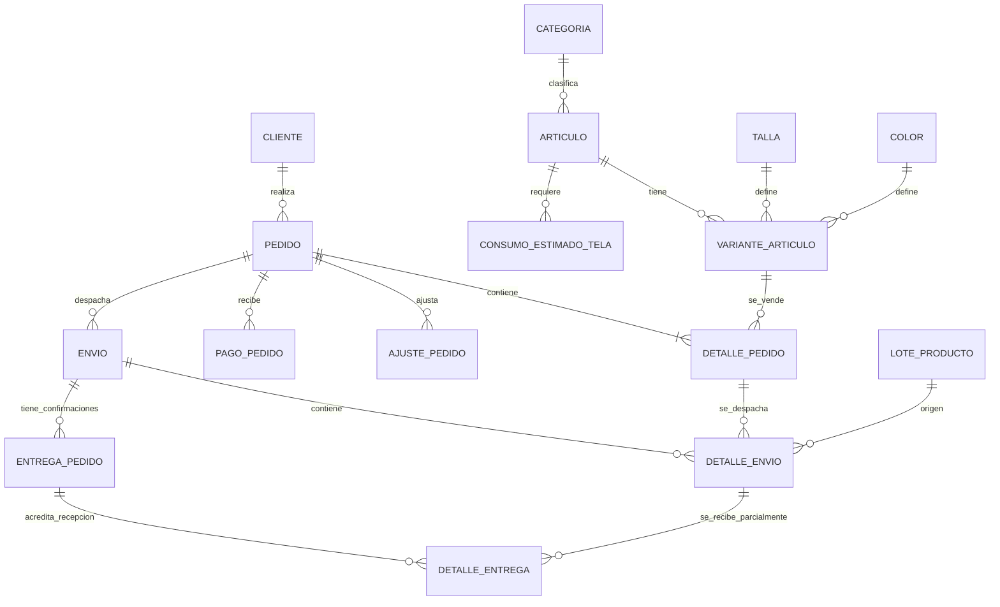
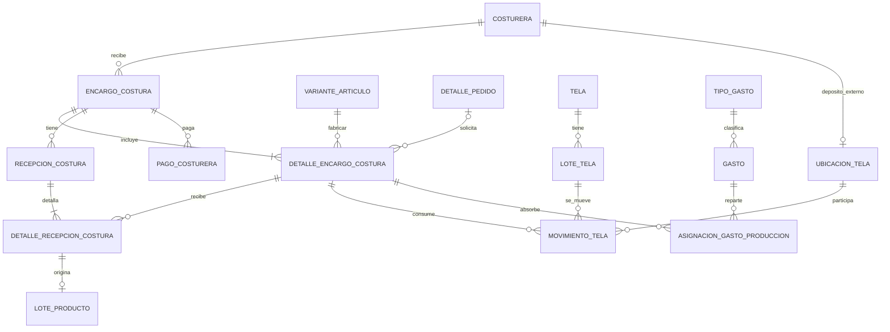
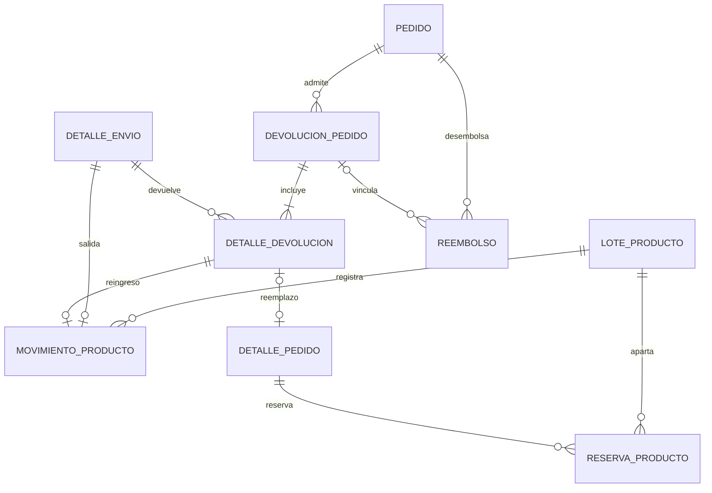
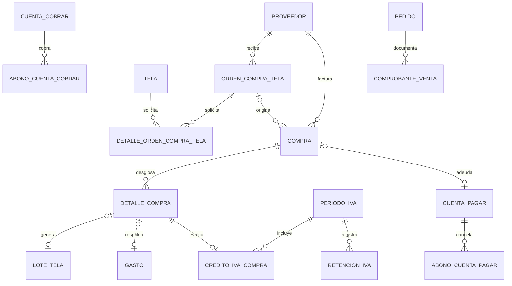

# bM — Modelo relacional de inventario, producción y ventas

**Versión:** 1.2 · **Motor sugerido:** PostgreSQL 15+ · **Moneda base:** USD

## 1. Alcance confirmado

1. Venta de prendas que ya están en inventario **y** producción bajo pedido.
2. Un mismo modelo puede confeccionarse con distintas telas, incluso combinadas.
3. Consumo estimado de tela configurable por modelo, opcionalmente por talla; el uso real se registra por lote y encargo.
4. Un mismo encargo a una costurera independiente puede contener varias tallas, colores y modelos; se admiten recepciones parciales.
5. Precio negociado por artículo de pedido, sin alterar el catálogo histórico.
6. IVA por artículo; se conserva la tasa aplicada a la fecha de venta. El envío tiene tratamiento tributario configurable por separado.
7. Anticipos, abonos, saldos, reembolsos y pagos de costura.
8. Se registran gastos de etiquetas, botones y empaques, **sin** administrar sus cantidades en inventario.
9. Cambios, devoluciones, reemplazos y reembolsos, manteniendo el historial original.
10. Margen por prenda a partir de lote de tela, mano de obra e insumos asignados.

## 2. Mapa original de las 32 tablas (v1.0)

| Área | Tablas | Responsabilidad |
|---|---|---|
| Catálogo | `categoria`, `articulo`, `variante_articulo`, `talla`, `color`, `consumo_estimado_tela` | Definir artículos, SKU y metraje de referencia |
| Telas | `tela`, `lote_tela`, `ubicacion_tela`, `movimiento_tela` | Control por compra, costo y lugar físico |
| Ventas | `cliente`, `pedido`, `detalle_pedido`, `pago_pedido`, `ajuste_pedido` | Venta histórica, IVA, abonos y cargos/créditos |
| Confección | `costurera`, `encargo_costura`, `detalle_encargo_costura`, `recepcion_costura`, `detalle_recepcion_costura`, `pago_costurera` | Producción tercerizada y pagos |
| Costeo | `lote_producto`, `tipo_gasto`, `gasto`, `asignacion_gasto_produccion` | Costos reales o provisionales por prenda |
| Envíos | `envio`, `detalle_envio` | Despacho parcial, precio real del courier y trazabilidad por lote |
| Posventa | `devolucion_pedido`, `detalle_devolucion`, `reembolso` | Cambios, devoluciones de producto, saldos y devolución de dinero |
| Inventario terminado | `movimiento_producto`, `reserva_producto` | Kardex y stock reservado |

La propuesta original contenía **32** tablas. La versión 1.1 incorporó **14** tablas financieras, de compras y tributarias. La versión **1.2** añade `entrega_pedido`, `detalle_entrega` y `tarifa_iva_vigencia`: **49 tablas en total**, junto con cuatro nuevas vistas para seguimiento de entregas. Las siete vistas originales y las cinco de v1.1 siguen presentes: **16 vistas de consulta en total**. Entre las consultas originales se incluyen: `v_existencia_tela`, `v_stock_lote_producto`, `v_stock_variante`, `v_estado_cuenta_pedido`, `v_saldo_pedido`, `v_margen_detalle_envio` y `v_margen_neto_articulo`.

## 3. Diagramas relacionales clave

### Productos, pedidos y envíos



### Producción, telas y costos



**Nota:** `movimiento_tela` cuenta con dos FKs opcionales a `ubicacion_tela`: origen y destino; el diagrama simplifica ambas en una sola conexión.

### Inventario y posventa



## 4. Reglas financieras

- **Precio registrado:** `detalle_pedido.precio_unitario_venta` es el precio negociado **antes de IVA**. `precio_lista_unitario` sirve para comparar con el catálogo del momento.
- **IVA de cada producto:** se determina con `aplica_iva` y `porcentaje_iva`, y se congela al confirmar el pedido. El modelo no presupone una tasa nacional permanente.
- **Envío al comprador:** `pedido.costo_envio_cobrado` y su IVA opcional forman parte del total a cobrar.
- **Envío pagado al courier:** `envio.costo_real_transportadora` es gasto real y no sustituye al importe facturado al cliente.
- **Total neto del pedido:** artículos + IVA de artículos + envío cobrado e IVA correspondiente + ajustes − créditos de devoluciones aprobadas.
- **Dinero neto recibido:** pagos confirmados − reembolsos completados.
- **Saldo:** total neto del pedido − dinero neto recibido. Un saldo negativo significa dinero a favor del cliente.
- **Rentabilidad por prenda:** ingreso sin IVA del artículo enviado − costo de fabricación del lote (tela + costura + insumos asignados). La vista `v_margen_neto_articulo` descuenta los créditos por devoluciones aprobadas y revierte el costo cuando la prenda efectivamente vuelve al inventario. El envío y los gastos generales no asignados deben calcularse aparte.

## 5. Ejemplos de operaciones

### A. Compra de tela y entrega a costurera

1. Registrar una tela en `tela` y la compra con costo específico en `lote_tela`.
2. Crear movimiento de tipo `compra` desde exterior (`origen=NULL`) a bodega.
3. Crear `encargo_costura` y sus líneas en `detalle_encargo_costura`.
4. Mover físicamente 18 m de tela desde bodega a ubicación de costurera con `movimiento_tela` de tipo `transferencia`.
5. Registrar el metraje realmente utilizado por cada línea en `movimiento_tela` de tipo `consumo`, con la costurera como origen.
6. Regresar sobrantes a bodega mediante `devolucion_tela`. La suma de movimientos determina lo que conserva cada lugar.

### B. Encargo y recepción parcial

1. La costurera recibe una orden con 5 S, 10 M y 5 L.
2. Entrega 12 camisas: crear `recepcion_costura` y líneas aceptadas/rechazadas.
3. Por cada línea con camisas aceptadas, crear un `lote_producto` y su `movimiento_producto` de entrada.
4. Al recibir las otras ocho, registrar otra recepción y los nuevos lotes.
5. Los gastos asignados a la confección se guardan por `detalle_encargo_costura`; los pagos hechos a la costurera no deben confundirse con el costo pactado/devengado de producción.

### C. Venta y cambio de talla

1. Una camisa M se vende con precio negociado de $30, IVA según su propia línea.
2. Se reserva producto si hay stock; al despachar, `detalle_envio` indica qué lote salió y `movimiento_producto` descuenta una unidad.
3. Si el cliente solicita otra talla, el producto original se documenta en `devolucion_pedido`/`detalle_devolucion` con su crédito monetario.
4. Se añade una nueva línea `detalle_pedido` de tipo `reemplazo` con la nueva variante y su propio precio/IVA.
5. La mercancía devuelta solo vuelve al stock si, después de inspección, es apta para la venta. El saldo se recalcula y, si corresponde, se registra un `reembolso`.

## 6. Cambios respecto de bM Base.pdf

| Tabla original | Tratamiento propuesto |
|---|---|
| `ARTICULO_TELA` | Se sustituye por `consumo_estimado_tela` y consumos reales registrados en `movimiento_tela` porque el modelo permite diferentes telas. |
| `VARIANTE_ARTICULO.stock_unidades` | Deja de editarse directamente; se calcula con movimientos y reservas. |
| `TELA.stock_metros` | Deja de editarse directamente; se calcula por lote y ubicación. |
| `ENTREGA_ENCARGO_TELA` | Su función se incorpora a `movimiento_tela` para auditar entregas, sobrantes y consumo real. |
| `ENCARGO_COSTURA.cantidad_camisas` | Se calcula como suma de sus líneas, sin mantener totales independientes. |
| `DETALLE_DEVOLUCION.talla_nueva_id` | Se elimina: la nueva variante ya define la talla y el color. |
| `PEDIDO.aplica_iva` | Se cambia por IVA por línea de pedido y posible IVA separado de envío. |
| `PEDIDO.total` | Se calcula en vistas para evitar desincronización; las líneas y ajustes conservan el historial. |
| `GASTO_INSUMO` | Se conserva funcionalmente como `gasto`, vinculado opcionalmente a producción y asignado entre las prendas. |

## 7. Invariantes que aún deben implementarse en el servicio de negocio

El archivo SQL **no implementa todavía toda la lógica de transacciones**. Antes de utilizar el sistema con inventario o dinero reales, deben exigirse estas garantías:

1. Nunca permitir saldo de tela ni stock físico negativo, ni stock reservado mayor al disponible. Usar transacciones y bloqueos de filas (o triggers serializados).
2. Verificar que el lote despachado o reservado corresponda exactamente a la variante pedida.
3. Verificar que envíos, devoluciones, reemplazos y reembolsos estén vinculados a los pedidos correctos.
4. Limitar cantidades: recibidas ≤ solicitadas, enviadas ≤ vendidas y devueltas ≤ enviadas.
5. Crear **en una misma transacción** el documento del movimiento y su asiento de inventario; evitar registrar dos veces el mismo evento (idempotencia).
6. Una devolución no debe acreditar dinero o devolver stock sin aprobar su estado correspondiente; nunca se debe acreditar dos veces.
7. La suma de asignaciones de un gasto no debe superar su monto; evitar usar la compra de tela a la vez como gasto adicional de insumos de producción.
8. Los costos de un lote pueden ser provisionales mientras el encargo esté abierto; deben finalizarse después de atribuir metraje y gastos definitivos.
9. Una vez confirmado un pedido, evitar reescribir o eliminar sus precios y cantidades originales; utilizar posventa y ajustes documentados.
10. Registrar quién creó y quién aprobó operaciones sensibles en la capa de usuarios/auditoría cuando se habilite el sistema multiusuario.

## 8. Módulos recomendados del programa

- Catálogo y variantes.
- Telas y movimientos entre bodega y costureras.
- Producción y recepciones.
- Inventario de camisas y reservas.
- Pedidos, cobros y envíos.
- Devoluciones y reembolsos.
- Gastos y rentabilidad.

**Decisión pendiente no bloqueante:** consumo estimado de tela por talla. El modelo ya admite una referencia genérica por modelo y sobrescrituras por talla, por lo que puedes comenzar sin definirla todavía.

**Otra decisión de implementación:** la política contable y fiscal de ajustes, facturación y devoluciones debe adaptarse a la documentación tributaria aplicable; este esquema modela la operación y no constituye por sí mismo un módulo de facturación electrónica.


---

## 9. Ampliación v1.1: cuentas pendientes, facturas, crédito tributario y costureras

### 9.1 Tabla de cobertura

| Requisito | Estado en v1.1 | Dónde se consulta |
|---|---|---|
| Deudas de clientes por pedidos | Ya existía | `v_saldo_pedido` |
| Deudas ajenas a pedidos (préstamos/otros) | Nuevo | `cuenta_cobrar`, `abono_cuenta_cobrar`, `v_saldo_cuenta_cobrar` |
| Deudas con proveedores y terceros | Nuevo | `cuenta_pagar`, `abono_cuenta_pagar`, `v_saldo_cuenta_pagar` |
| Deudas a costureras por camisas confeccionadas | Vista nueva sobre tablas existentes | `v_saldo_costurera_encargo` |
| Órdenes de compra de tela | Nuevo | `orden_compra_tela`, `detalle_orden_compra_tela` |
| Factura y lugar de compra | Nuevo | `proveedor`, `compra`, `detalle_compra` |
| Precio de tela con y sin IVA | Nuevo | `v_costo_compra_tela` |
| IVA elegible y crédito aprobado | Nuevo | `configuracion_tributaria`, `periodo_iva`, `credito_iva_compra` |
| Comprobantes de ventas y retenciones | Nuevo | `comprobante_venta`, `retencion_iva` |
| Mano de obra por camisa | Ya existía | `detalle_encargo_costura.tarifa_mano_obra_unitaria` |

### 9.2 Relaciones del nuevo módulo



### 9.3 Compra de tela: pedido, recepción y factura son eventos distintos

1. `orden_compra_tela`: intención de comprar, proveedor y tienda prevista. **No aumenta stock**.
2. `compra`: operación y documento recibido, fecha de emisión, local de compra, número de factura y clave de acceso cuando exista; se registra estado de verificación documental. Puede haber más de una compra de una misma orden.
3. `detalle_compra`: cada tipo/color de tela comprado, cantidad en metros, precio neto, descuento, tarifa IVA, IVA separado y otros cargos. Admite asimismo servicios e insumos sin stock.
4. `lote_tela`: lote recibido físicamente con `detalle_compra_id`; genera movimiento de inventario al ingresar, no al crear la orden.
5. `cuenta_pagar`: valor pendiente al proveedor, contra el que se realizan pagos parciales. La factura es una sola fuente de obligación.

El número de comprobante y la clave de acceso se registran **como datos diferentes**. La mera digitación de un número no acredita por sí sola validez ni derecho al crédito de IVA.

### 9.4 Dos precios por metro y el costo correcto de la camisa

Ejemplo, 20 metros a **$5 sin IVA por metro**, IVA ilustrativo 15%:

- Subtotal: $100,00; IVA en factura: $15,00; total: $115,00.
- **Precio sin IVA:** $5,00/m. **Precio con IVA:** $5,75/m.
- Si los $15,00 son crédito tributario válidamente aceptado y totalmente recuperable, costo inventariable básico: **$5,00/m**.
- Si no son recuperables, costo inventariable básico: **$5,75/m**, sin considerar flete u otros costos atribuibles.
- Si únicamente $6,00 de IVA son recuperables, costo estimado por metro: **($115−$6)/20 = $5,45/m**.

`v_costo_compra_tela` muestra las tres cifras y el estado provisional/revisado. El crédito solo consta en `credito_iva_compra` si es **aprobado**; no se presupone que todo IVA facturado sea crédito. El costo real `lote_tela.costo_metro` ha de reconciliarse con esta vista antes de finalizar costos de confección, para que la rentabilidad histórica no varíe de modo inconsistente. En todo caso, si la tela no se recupera en el inventario o se clasifica como gasto, el tratamiento de IVA y costo debe ser revisado contablemente.

### 9.5 Crédito tributario ecuatoriano: asistencia, no declaración autónoma

Se agregó un módulo de **evaluación documentada** que conserva comprobantes, tipos de IVA, períodos mensuales/semestrales, posible factor de proporcionalidad, retenciones y crédito aprobado. No se presume ninguna tasa fija del IVA; las tasas se guardan en cada movimiento para conservar el histórico.

La **LRTI (art. 66)** y el **Reglamento (art. 153)** regulan los requisitos de aprovechamiento de crédito tributario (incluidos comprobantes autorizados e IVA separado), que pueden ser totales, proporcionales o no aplicables según el destino, las ventas y el régimen. También deben verificarse los casos de operaciones con tarifa cero, exentas o no objeto, que no equivalen entre sí.

`v_resumen_iva_periodo` es una **vista de apoyo**, con IVA documentado en facturas de venta autorizadas, crédito aprobado en compras y retenciones validadas. No es la declaración tributaria: faltará implementar la conciliación documental, clasificación fiscal definitiva, potenciales ajustes, notas de crédito y los requisitos del régimen específico de bM, con supervisión contable.

### 9.6 Costureras: mano de obra **por camisa aceptada**

El costo de confección sigue almacenado **por unidad** en `detalle_encargo_costura.tarifa_mano_obra_unitaria`. Un encargo admite varias tallas y tarifas diferentes. La vista `v_saldo_costurera_encargo` calcula:

**Deuda por encargo = SUMA(camisas recibidas y aceptadas × tarifa por camisa) − SUMA(pagos confirmados)**.

Ejemplo: seis camisas a $5 y cuatro a $6, total $54. Si hay un abono de $20, saldo **$34 por pagar**. Los anticipos antes de la recepción pueden producir saldo negativo temporal (anticipo entregado a la costurera, pendiente de compensación); no generan un segundo costo de producción.

Para evitar doble contabilización, los pagos a costureras por la confección original se registran exclusivamente en `pago_costurera`, no en una cuenta a pagar genérica por ese mismo encargo. `cuenta_pagar` sí permite registrar **otras** deudas con una costurera que no provengan de prendas encargadas.

### 9.7 Reglas de aplicación pendientes

- La base SQL crea estructuras, restricciones locales, índices y vistas, **pero no ejecuta por sí sola** verificaciones externas del SRI, clasificación fiscal, límites de pagos, conciliaciones con facturas ni cierres tributarios.
- Evitar duplicidad entre el documento `compra`, `cuenta_pagar` y sus abonos; y entre `gasto` y `detalle_compra`.
- Verificar que un `lote_tela` tenga el mismo tipo/color de tela y metraje que su `detalle_compra` asociado; conciliación transaccional.
- Impedir que créditos del IVA aprobados excedan el IVA facturado y que se aprueben sin documento que cumpla requisitos. El factor de proporcionalidad debe sustentarse por período y el uso o saldo a favor debe respetar la norma aplicable.
- Reconciliar el costo inventariable por lote antes de publicar márgenes definitivos.
- Mantener el documento original, reversos y ajustes en cambios/reembolsos sin modificar el historial.

**Dato a confirmar antes de automatizar impuestos:** el régimen tributario efectivo y las obligaciones específicas de bM (por ejemplo, RIMPE o régimen general), así como si deben emitirse documentos electrónicos dentro del propio programa o solo archivarse los emitidos con un facturador externo.

**Normativa de referencia:** Servicio de Rentas Internas, página informativa de IVA, Ley de Régimen Tributario Interno art. 66, Reglamento de aplicación art. 153 y especificaciones de comprobantes electrónicos. Confirmar las normas vigentes al momento de implementación.


## 9. Configuración tributaria confirmada: persona natural, régimen general

- **Titular:** persona natural; **régimen:** general. La marca comercial bM no sustituye la identificación fiscal del contribuyente que figura en el RUC y emite la factura.
- `configuracion_tributaria.regimen` tiene valor inicial `general`; `tipo_contribuyente` tiene `persona_natural`.
- El campo `obligado_a_llevar_contabilidad` es **opcional** hasta verificar la condición del RUC; régimen general no equivale por sí solo a llevar contabilidad obligatoria.
- En compras de tela conservar el precio sin IVA y con IVA, el número de factura, la identificación del emisor, IVA documentado y el crédito efectivamente aceptado. En el costo de fabricación, solo se excluye el IVA recuperable según su evaluación.
- `tarifa_iva_vigencia` guarda las tarifas con fechas de aplicación; **no se cargaron tasas fijas** ni se presumió el período de declaración del negocio.
- Los comprobantes de venta y notas de crédito deben registrarse independientemente de la entrega logística. No presumir que cada entrega parcial genera, por sí sola, una nueva factura o una fecha específica de hecho generador de IVA.
- El módulo de IVA es auxiliar; la configuración de periodicidad, obligación contable, agentes de retención y emisión documental debe contrastarse con el RUC y un profesional tributario.

## 10. Entregas parciales por pedido (v1.2)

El esquema v1.1 permitía varios despachos (`envio` + `detalle_envio`), pero no podía representar con precisión que **se despacharan tres camisas y el cliente recibiera dos**, ni resumir lo pendiente de cada línea.

### Nuevas tablas

| Tabla | Qué registra | Relación |
|---|---|---|
| `entrega_pedido` | Evento de recepción por el cliente, fecha, receptor, prueba de recepción y estado | Cada evento pertenece a un `envio` |
| `detalle_entrega` | Cuántas unidades de un renglón de envío se recibieron en ese evento | Cada línea se vincula a un `detalle_envio` y debe compartir `envio_id` con su cabecera |
| `tarifa_iva_vigencia` | Código de tarifa, porcentaje y fechas de validez | Referencia configurable de legislación, sin valores fijos precargados |

**Campos ampliados:** `envio.modalidad_entrega` (transportadora, mensajería, entrega personal, retiro); `envio.estado` admite `parcialmente_entregado`; `detalle_pedido.cantidad_cancelada` y `motivo_cancelacion`, con chequeo de cantidad y ajuste financiero separado.

### Vista por línea de pedido: `v_cumplimiento_detalle_pedido`

| Concepto | Fórmula |
|---|---|
| Unidades comprometidas | Pedidas − canceladas |
| Pendientes por despachar | Máximo(0, comprometidas − despachadas) |
| Unidades en tránsito | Máximo(0, despachadas − entregadas confirmadas) |
| Pendientes por entregar | Máximo(0, comprometidas − entregadas confirmadas) |

### Ejemplo: tres camisas, solo dos entregadas

Pedido #001, cliente compra **2 azules M + 1 verde L**:

| Variante | Pedidas | Despachadas | Entregadas confirmadas | Pendientes |
|---|---:|---:|---:|---:|
| Azul M | 2 | 1 | 1 | 1 |
| Verde L | 1 | 1 | 1 | 0 |
| **TOTAL** | **3** | **2** | **2** | **1** |

- `v_estado_entrega_pedido` → `parcialmente_entregado` y cantidad pendiente 1.
- `v_pedidos_por_entregar` incluye ese pedido hasta registrar la entrega de la camisa pendiente.
- `v_pedidos_entregados` contiene el pedido solo después de confirmar la última unidad.
- Las devoluciones posteriores mantienen el historial de entrega y utilizan `detalle_devolucion`; si hay un cambio de talla se crea la nueva línea de reemplazo.
- Pedido **pagado** no implica pedido **entregado**: las vistas consultan entregas confirmadas, no los pagos.

### Dos situaciones distintas

1. **Solo se despacharon 2 de 3:** `pendiente_despacho = 1`, `en_transito = 0` si las 2 ya se confirmaron recibidas.
2. **Se despacharon 3, se recibieron 2:** `pendiente_despacho = 0`, `en_transito = 1` hasta que la unidad se reciba o se documente una incidencia; habrá que resolver las pérdidas/roturas con un flujo aparte.

### Consultas de pantalla

```sql
-- Pedidos pendientes o parcialmente entregados:
SELECT pedido_id, nombre_cliente, estado_entrega,
       unidades_por_despachar, unidades_en_transito,
       unidades_pendientes_entrega
FROM v_pedidos_por_entregar
ORDER BY fecha_pedido;

-- Pedidos recibidos por completo:
SELECT pedido_id, nombre_cliente, unidades_entregadas
FROM v_pedidos_entregados
ORDER BY fecha_pedido DESC;

-- Prendas que faltan por pedido:
SELECT pedido_id, sku_vendido, cantidad_comprometida,
       cantidad_despachada, cantidad_entregada, pendiente_entrega
FROM v_cumplimiento_detalle_pedido
WHERE pedido_id = 1;
```

### Integridad de operaciones que debe implementar el servicio

- La suma de recepciones confirmadas de un `detalle_envio` nunca excede las unidades despachadas en esa línea.
- Una línea no podrá despacharse en conjunto más veces que el compromiso vigente (pedido menos cancelaciones válidas).
- Una entrega debe corresponder al mismo despacho y a la misma línea de pedido (FK compuesta ya evita mezclar envíos).
- No se confirma recepción sin despacho real ni se duplica una confirmación por reintentos.
- Despachar descuenta stock **una vez**; confirmar entrega no vuelve a descontar stock.
- Si una línea se cancela después de cobrarla, registrar el ajuste económico y el comprobante tributario correspondiente; la columna `cantidad_cancelada` por sí sola no modifica el cobro.
- Antes de utilizar los reportes en una instalación que ya tenga datos de v1.1, reconstruir de forma auditada sus confirmaciones históricas de entrega. No inferir entregas individuales desde `envio.estado`.

## 11. Historial de versiones

- **v1.0:** catálogo, telas, fabricación, pedidos, envíos, cambios y costos.
- **v1.1:** compras, proveedores, crédito IVA, saldos por cobrar y por pagar.
- **v1.2:** régimen general/persona natural, tarifa IVA por vigencia y recepción parcial con vistas de pendientes y entregados.
